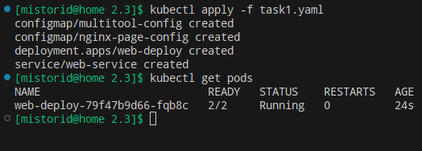
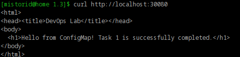
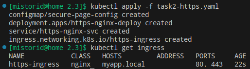
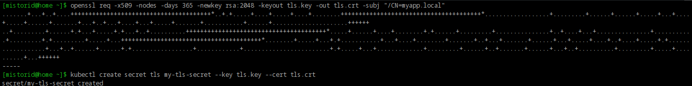
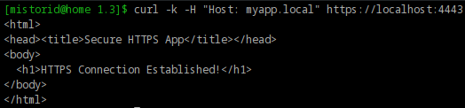

# Домашнее задание к занятию "`Конфигурация приложений`" - `Шмагин Максим`

## Задание 1

## Задание 2

На скриншоте указан порт "4443", так как выполняю команды от пользователя, а порт 443 это системный порт и для него нужны права супер пользователя.